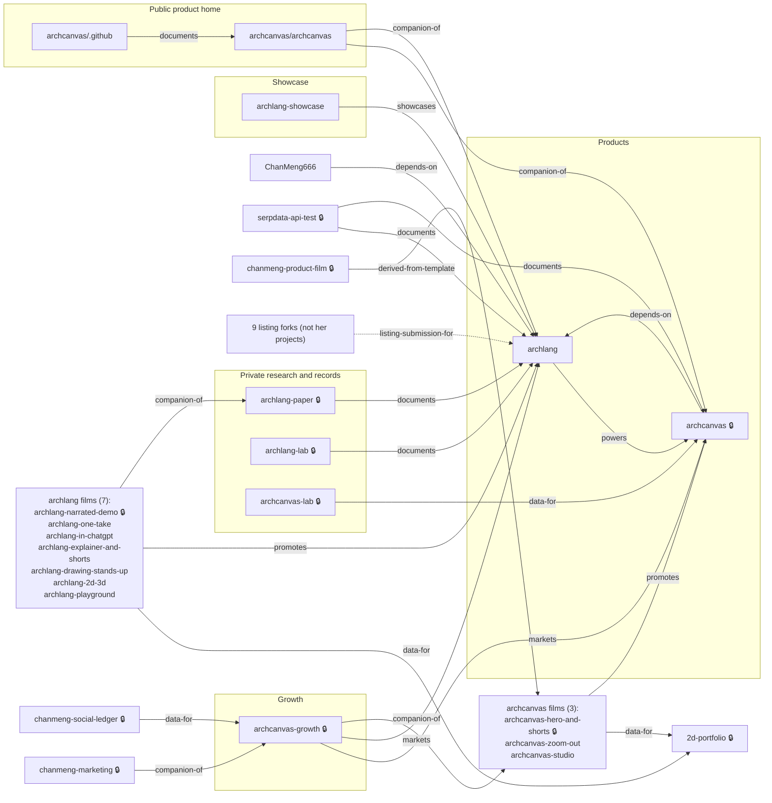

<!-- GENERATED by scripts/build-archlang-context.mjs from docs/ecosystem/lineage.yaml, data/profile/45-showcase.yaml and the local package.json files. Do not edit: change the sources and run npm run build:archlang-context. -->

# ArchLang project graph (agent context)

Hand this file to an agent at the start of ArchLang work. Catalog verified 2026-11-17; local checkouts read at build time. Topology only: career facts live in `data/profile/`, decisions in `docs/STATE.md`.

Read in this order: §1 rules, §2 the graph, §3 where each repo is, §4 what is inside archlang, §5 who consumes it, §6 every edge.

## 1. Rules for working in these repos

- **Priorities (Chan, 2026-11-18 and 2026-11-20).** ArchLang builds by roadmap v3 (`archlang/docs/plans/product-roadmap/v3.md`, the one build order; started by RM-D65): numbers said right, checker recall, edits, handover; 1.64.0 shipped 2026-11-18. ArchCanvas is ArchLang's test bench plus a niche product for self-builders (growth ruling 2026-11-18); its plan is `archcanvas-lab/specs/2026-11-18-archcanvas-plan-after-demand-synthesis.md`; its stages 1 and 2 shipped by 2026-11-19, its rebuilt public site went live on 2026-11-20, and on 2026-11-22 it dropped AI renderings (the 3D preview is the only picture of the building) and let a stranger's first design start before sign-up (a one-step account, Google or an emailed code, keeps it for one credit; a person's first account's free one, since 2026-11-23 given once per person and per browser). Chan ruled on 2026-11-20 that ArchCanvas's next stage is judged by the time to a first design and the share of first designs that pass the checks, through the plan-quality and compiler line; no targets or levers are chosen yet (as of 2026-11-24: archcanvas `main` `a9600223`, core `@chanmeng666/archlang` 1.68.2 and `@chanmeng666/archlang-3d` 0.9.2, consumed the day they shipped; the public product home `archcanvas/archcanvas` was updated 2026-11-22). ArchCanvas's current state is the newest dated handoff in `archcanvas-lab/specs/` (2026-11-24: `2026-11-24-handoff-signup-audit-round.md`; index `specs/README.md`); ArchLang's is `archlang/docs/plans/product-roadmap/handoff.md`. ArchCanvas is an AI architectural designer, never an "AI architect"; the 3D is the "3D preview" (ArchCanvas makes no AI images since 2026-11-22). No copy says a launch is planned.
- **Origin order.** ArchCanvas came first (first commit 2026-04-08, freehand SVG plans); ArchLang npm 0.1.0 followed on 2026-06-24 and replaced that engine on 2026-06-25. Never write that the language came first.
- **Truth ownership.** Language behaviour lives in `archlang`; product behaviour in `archcanvas`; strategy, decisions and launch copy in `archcanvas-growth`. Growth holds no product truth; never edit a product repo from growth.
- **Links.** Public copy links only `github.com/ChanMeng666/archlang`, `github.com/ChanMeng666/archlang-showcase`, `github.com/archcanvas/archcanvas` and the public film repos. A private repo is named, never linked.
- **Private records.** `archlang-paper` stays private (the paper is public only as a Zenodo preprint); never name a venue. `archlang-lab` and `archcanvas-lab` hold closed research and eval data; tests in the product repos never read them.
- **No D:/ paths in a product repo.** This file's local paths are for Chan's machine; never copy them into `AGENTS.md`, `CLAUDE.md` or docs of `archlang`, which are for every contributor.
- **One film on show per product** (`productFilms`): archcanvas-studio-film: `film-archcanvas-studio`; archlang-film: `film-archlang-2d-3d`. Film repos coexist; none replaces another. The ArchCanvas films do not name ArchLang on screen.
- **Do not confuse.** `archcanvas/archcanvas` (folder `archcanvas-public`) is the public product home, not the app; the app is the private `ChanMeng666/archcanvas`. `docs-site/` and `playground/` are workspaces of `archlang`, not repos, and the playground is not ArchCanvas. The gallery sources are in `archlang-showcase`; the docs-site `/showcase` images are synced copies. `"private": true` in the showcase `package.json` only means not published to npm: the repo is public MIT. The `.arch` keyword `paper` is a sheet size, unrelated to `archlang-paper`. `chanmeng-readme-showcase` and the career-shard id `app-promo-studio` are unrelated projects (name collisions only).
- **Path coupling between sibling checkouts.** The playground builds against the core's built `../dist` (`playground/vite.config.js`), so build the core first. The docs site copies `docs/` in with `npm run sync` (`docs-site/sync-docs.mjs`). `archcanvas` eval and diagnostics scripts read and write the sibling `../archcanvas-lab`, or `$ARCHCANVAS_LAB` when set. `archlang-paper` tooling reads the sibling `../archlang`; `film-archcanvas-studio` syncs a checksum-locked replica one way from `../archcanvas`.
- **Licences.** `archlang`, `archlang-showcase` and the public film repos: MIT (film media CC BY 4.0, per each repo's `LICENSE-MEDIA.md`). `archcanvas/archcanvas`: the product is all rights reserved; its Markdown docs and `examples/**/*.arch` with their compiled SVGs are CC BY 4.0. `archcanvas` (the app) is proprietary.

## 2. Graph

🔒 = private repository. Edge labels are the relation types defined in §6.



## 3. Repositories

| Repo | Local path | GitHub | Role | Stage | What it is |
|---|---|---|---|---|---|
| archlang | `D:/github_repository/archlang` | [ChanMeng666/archlang](https://github.com/ChanMeng666/archlang) | product | building | ArchLang DSL and compiler to SVG/DXF/PDF floor plans; monorepo hosts docs-site and playground Live: https://archlang.uk, https://playground.archlang.uk |
| archcanvas | `D:/github_repository/archcanvas` | `ChanMeng666/archcanvas` (private: never link) | product | building | Closed-source ArchCanvas AI floor-plan app (Next.js); consumes ArchLang via npm Live: https://archcanvas.uk |
| film-archlang-playground | not cloned | [ChanMeng666/film-archlang-playground](https://github.com/ChanMeng666/film-archlang-playground) | promo-film | done | ArchLang promo film: 68 s Remotion video, coded replica of the playground, plans compiled in-render by the real compiler Live: https://chanmeng.org/ |
| archcanvas-growth | `D:/github_repository/archcanvas-growth` | `ChanMeng666/archcanvas-growth` (private: never link) | growth | building | Private growth/strategy HQ for ArchCanvas and ArchLang; editorial authority for the promo repos |
| film-archcanvas-hero-and-shorts | `D:/github_repository/film-archcanvas-hero-and-shorts` | `ChanMeng666/film-archcanvas-hero-and-shorts` (private: never link) | promo-film | done | First ArchCanvas promo: 92 s HyperFrames film plus six shorts (14 masters) |
| film-archcanvas-zoom-out | not cloned | [ChanMeng666/film-archcanvas-zoom-out](https://github.com/ChanMeng666/film-archcanvas-zoom-out) | promo-film | done | Second ArchCanvas promo: Remotion Zoom Out in four aspect ratios |
| film-archcanvas-studio | not cloned | [ChanMeng666/film-archcanvas-studio](https://github.com/ChanMeng666/film-archcanvas-studio) | promo-film | done | Third ArchCanvas promo: Remotion film from a coded replica of the studio UI, 4 cuts x 2 ratios |
| archlang-paper | `D:/github_repository/archlang-paper` | `ChanMeng666/archlang-paper` (private: never link) | paper | building | ArchLang papers plus reproduction scripts; private until acceptance |
| archlang-lab | `D:/github_repository/archlang-lab` | `ChanMeng666/archlang-lab` (private: never link) | research | maintained | Closed ArchLang programme research, audits, spikes and research scripts moved out of the public repo; its tests never read it |
| archcanvas-lab | `D:/github_repository/archcanvas-lab` | `ChanMeng666/archcanvas-lab` (private: never link) | research | maintained | ArchCanvas recorded eval runs and the append-only dated decision records moved out of the product repo; its tests never read it |
| archlang-showcase | `D:/github_repository/archlang-showcase` | [ChanMeng666/archlang-showcase](https://github.com/ChanMeng666/archlang-showcase) | showcase | maintained | Gallery of famous/TV/game floor plans written in .arch Live: https://archlang.uk/showcase |
| film-archlang-narrated-demo | not cloned | `ChanMeng666/film-archlang-narrated-demo` (private: never link) | demo | done | Narrated 4:47 Remotion demo film of ArchLang 1.36.0; unlisted YouTube; accompanies the paper's tool demo; keep venue details out of public material |
| archcanvas/archcanvas | `D:/github_repository/archcanvas-public` | [archcanvas/archcanvas](https://github.com/archcanvas/archcanvas) | docs | maintained | Public ArchCanvas product home: examples, docs, roadmap; not the application source Live: https://archcanvas.uk |
| archcanvas/.github | `D:/github_repository/archcanvas-org-profile` | [archcanvas/.github](https://github.com/archcanvas/.github) | docs | done | GitHub org profile README for the archcanvas organisation |
| film-archlang-one-take | not cloned | [ChanMeng666/film-archlang-one-take](https://github.com/ChanMeng666/film-archlang-one-take) | promo-film | done | 32 s one-take film for ArchLang: one three.js file, a Blender-built house and a score from CC0 instrument samples on one beat table; master in release v1.0.0 |
| film-archlang-in-chatgpt | not cloned | [ChanMeng666/film-archlang-in-chatgpt](https://github.com/ChanMeng666/film-archlang-in-chatgpt) | promo-film | done | 82 s film of ArchLang inside ChatGPT: a coded replica of the real pages in Remotion, real compiler output and an original sampled score; master in release v1.0.0 |
| film-archlang-explainer-and-shorts | not cloned | [ChanMeng666/film-archlang-explainer-and-shorts](https://github.com/ChanMeng666/film-archlang-explainer-and-shorts) | promo-film | done | 91 s explainer film for ArchLang, with 27 s, 28.5 s and 25 s cutdowns: Python motion compositor and ffmpeg, real compiler and archlang-3d output; masters in release v1.0.0 |
| film-archlang-drawing-stands-up | `D:/github_repository/film-archlang-drawing-stands-up` | [ChanMeng666/film-archlang-drawing-stands-up](https://github.com/ChanMeng666/film-archlang-drawing-stands-up) | promo-film | done | Blender-rendered ArchLang films and stills: the 32 s hero film The drawing stands up (16:9 and 9:16), a 12 s code-to-form clip and five stills in three aspects; all geometry from the compiler and archlang3d; masters in release v0.4.0 |
| film-archlang-2d-3d | `D:/github_repository/film-archlang-2d-3d` | [ChanMeng666/film-archlang-2d-3d](https://github.com/ChanMeng666/film-archlang-2d-3d) | promo-film | done | 196 s feature explainer of ArchLang, from one .arch file to a self-checking dimensioned plan and a 3D preview: Remotion, real compiler and archlang-3d, English voice-over, 30 s cuts in 16:9 and 9:16; masters in release v1.0.0 Live: https://chanmeng.org/, https://archlang.uk/ |
| chanmeng-social-ledger | `D:/github_repository/chanmeng-social-ledger` | `ChanMeng666/chanmeng-social-ledger` (private: never link) | data-export | maintained | Private source of truth for her social-media data (own posts, comments, replies and DMs across X, LinkedIn, Reddit, GitHub, Hacker News and dev.to), with the capture tools, raw archives and the privacy-gated export of her own posts to the x/ and linkedin/ registers here; home of the x-sync and linkedin-sync skills |
| 2d-portfolio | `D:/github_repository/2d-portfolio` | `ChanMeng666/2d-portfolio` (private: never link) | product | maintained | Next.js portfolio site serving chanmeng.org (also /cv and /blog) Live: https://chanmeng.org/ |
| ChanMeng666 | `D:/github_repository/ChanMeng666` | [ChanMeng666/ChanMeng666](https://github.com/ChanMeng666/ChanMeng666) | profile | maintained | GitHub profile README repo, now Chan's generated career database (shards to README, llms.txt, CVs, LinkedIn copy) Live: https://chanmeng.org/ |
| chanmeng-marketing | `D:/github_repository/chanmeng-marketing` | `ChanMeng666/chanmeng-marketing` (private: never link) | growth | maintained | The one marketing calendar and resource index, with the daily /today run |
| serpdata-api-test | `D:/github_repository/serpdata-api-test` | `ChanMeng666/serpdata-api-test` (private: never link) | experiment | paused | Test/demo project for the SerpData Google SERP API |
| chanmeng-product-film | not cloned | `ChanMeng666/chanmeng-product-film` (private: never link) | skill | maintained | Skill for coded-UI-replica product promo films (Remotion, Suno, ElevenLabs); case study is ArchCanvas |

"not cloned": no local checkout; clone it under `D:/github_repository/` when needed. Film masters are release assets of each film repo.

## 4. Inside the archlang monorepo

`D:/github_repository/archlang`, package `@chanmeng666/archlang` 1.68.2 (2026-11-24). Pushing `main` deploys the docs site (archlang.uk) and the playground (playground.archlang.uk).

| Workspace | Package | Version | On npm |
|---|---|---|---|
| `editors/vscode` | `archlang` | 0.56.2 | no (private; published to the VS Code Marketplace and Open VSX) |
| `playground` | `archlang-playground` | 0.0.0 | no (private) |
| `docs-site` | `archlang-docs` | 0.0.0 | no (private) |
| `packages/archlang-3d` | `@chanmeng666/archlang-3d` | 0.9.2 | yes |
| `packages/font-cjk` | `@chanmeng666/archlang-font-cjk` | 1.0.0 | yes |
| `packages/mcp` | `@chanmeng666/archlang-mcp` | 0.2.53 | yes |
| `packages/mcp-worker` | `archlang-mcp-worker` | 0.1.0 | no (private) |
| `packages/web-component` | `@chanmeng666/arch-plan` | 0.1.2 | yes |

Also in the repo, not workspaces: `skills/` (`archlang`, `archlang-brief-to-plan`, `archlang-edit-plan`, `archlang-export`, `archlang-review-plan`), `plugins/`, `integrations/`, `dataset/` (source of the Hugging Face dataset; there is no separate clone), `examples/` (small fixtures, not the gallery).

## 5. Who consumes the npm packages

Change a public API and these break. Ranges as written in each package.json.

| Local folder | Repo | Depends on |
|---|---|---|
| `D:/github_repository/archcanvas` | ChanMeng666/archcanvas 🔒 | `@chanmeng666/archlang@^1.68.2`, `@chanmeng666/archlang-3d@^0.9.2` |
| `D:/github_repository/archlang-showcase` | ChanMeng666/archlang-showcase | `@chanmeng666/archlang@^1.55.0` |
| `D:/github_repository/ChanMeng666` | ChanMeng666/ChanMeng666 | `@chanmeng666/archlang@^1.55.0` |
| `D:/github_repository/film-archlang-2d-3d` | ChanMeng666/film-archlang-2d-3d | `@chanmeng666/archlang@1.57.0`, `@chanmeng666/archlang-3d@0.4.0` |
| `D:/github_repository/film-archlang-drawing-stands-up` | ChanMeng666/film-archlang-drawing-stands-up | `@chanmeng666/archlang@1.56.0`, `@chanmeng666/archlang-3d@0.3.0` |

## 6. Every edge

One line per relation, `from --type--> to`, with its evidence.

```text
chanmeng-social-ledger --data-for--> archcanvas-growth   # mounted read-only as a git submodule at ledger/; holds the growth repo's pre-ledger trackers in archive/growth-legacy/
archcanvas --depends-on--> archlang   # package.json @chanmeng666/archlang ^1.68.2 and @chanmeng666/archlang-3d ^0.9.2 (2026-11-24, archcanvas PR #411; 1.68.1 in PR #406; 1.62 to 1.64.0 in PR #337, 2026-11-18)
archlang --data-for--> archcanvas-growth   # weekly data/web-traffic.csv: Web Analytics page loads, share-link events, and the catalogued diagnostic codes the hosted MCP and the playground count (no content), since 2026-11-22/23
archcanvas --data-for--> archlang   # generation_attempts records each generation's catalogued diagnostic codes (2026-11-23), the signal that picks archlang's next spec, error and fix work
archlang --powers--> archcanvas   # ArchLang compiler is the plan engine; replaced the freehand engine 2026-06-25
archcanvas/archcanvas --companion-of--> archcanvas   # public product home; the app source stays private
archcanvas/.github --documents--> archcanvas/archcanvas   # org profile README links product, public repo and language
archcanvas-growth --markets--> archcanvas   # growth HQ for both products
archcanvas-growth --markets--> archlang   # growth HQ for both products
film-archcanvas-hero-and-shorts --promotes--> archcanvas   # stages assets from ../archcanvas
film-archcanvas-hero-and-shorts --data-for--> film-archcanvas-zoom-out   # zoom-out's npm run sync:assets copies from ../archcanvas-promo-video (this repo's old name); the films coexist (q31), neither replaces the other
film-archcanvas-hero-and-shorts --data-for--> 2d-portfolio   # the 92 s film and six shorts are rows of 46-films.yaml, shown on chanmeng.org/films
film-archcanvas-zoom-out --data-for--> 2d-portfolio   # archcanvas-zoom-out is a row of 46-films.yaml, shown on chanmeng.org/films
film-archlang-explainer-and-shorts --data-for--> 2d-portfolio   # archlang-explainer-film is a row of 46-films.yaml, shown on chanmeng.org/films
film-archlang-drawing-stands-up --data-for--> 2d-portfolio   # archlang-drawing-stands-up is a row of 46-films.yaml, shown on chanmeng.org/films
film-archlang-narrated-demo --data-for--> 2d-portfolio   # archlang-demo is a row of 46-films.yaml; on chanmeng.org/films since 2026-11-07 (docs/STATE.md)
ChanMeng666 --depends-on--> archlang   # package.json @chanmeng666/archlang ^1.55.0; scripts/cards/archlang.mjs and archcanvas.mjs compile real plans for the README cards
chanmeng-marketing --companion-of--> archcanvas-growth   # resources.yaml entry archcanvas-archlang points its strategy, plan, voice, copy, messaging, brand and launches at archcanvas-growth; the dates live in chanmeng-marketing/calendar.yaml
serpdata-api-test --documents--> archlang   # scripts/analyze-arch-projects.js: SERP and AI Overview study of archlang.uk and archcanvas.uk (reports/arch-projects-analysis.md, 2026-11-03)
serpdata-api-test --documents--> archcanvas   # same study, archcanvas.uk half
film-archcanvas-zoom-out --promotes--> archcanvas   # Zoom Out film of the canvas
film-archcanvas-studio --promotes--> archcanvas   # npm run sync:replica from ../archcanvas, checksum-locked
archcanvas-growth --companion-of--> film-archcanvas-studio   # editorial authority for all three promo repos
archlang-paper --documents--> archlang   # tooling reads sibling ../archlang
archlang-lab --documents--> archlang   # closed programme research moved out of archlang docs/plans at 79e91d4e (2026-11-04)
archcanvas-lab --data-for--> archcanvas   # archcanvas eval and diagnostics scripts read and write ../archcanvas-lab/benchmarks/data; data moved out at 01edfd10 (2026-11-04)
archlang-showcase --showcases--> archlang   # npm dependency; shard relatedProjectIds [archlang]
archlang-showcase --deployed-as--> archlang.uk/showcase   # homepageUrl
film-archlang-narrated-demo --promotes--> archlang   # README: demo film of ArchLang 1.36.0; footage from tag v1.36.0
film-archlang-narrated-demo --companion-of--> archlang-paper   # README: accompanies the tool-demonstration paper, which lives under archlang-paper/demo/
chanmeng-product-film --derived-from-template--> film-archcanvas-studio   # verified 2026-10-03 from repo contents: the skill's references/case-study-archcanvas.md describes this production (4 lengths x 2 aspects, coded UI replica one-way synced and sha256-locked from the product repo, two earlier films not ported = archcanvas-promo-video 92 s and archcanvas-promo-remotion pull-back); the studio repo carries .claude/skills/promo-film, the pre-distillation form
film-archlang-explainer-and-shorts --renamed-from--> ext: ChanMeng666/archlang-spectacle   # gh repo rename 2026-11-06 under the film repo naming rule (docs/STATE.md); the old address redirects
film-archlang-drawing-stands-up --renamed-from--> ext: ChanMeng666/archlang-cinematic   # gh repo rename 2026-11-07 under the film repo naming rule (docs/STATE.md), Chan's request in chat; the old address redirects
film-archlang-one-take --promotes--> archlang   # GitHub description and README: the promo film for archlang, drawn from its real compiler output
film-archlang-in-chatgpt --promotes--> archlang   # GitHub description and README: a film of ArchLang at work inside ChatGPT, drawn from its real compiler output
film-archlang-explainer-and-shorts --promotes--> archlang   # GitHub description and README: films that show ArchLang compiling one .arch file into a precise plan, lint, exports and daylight 3D
film-archlang-drawing-stands-up --promotes--> archlang   # GitHub description and README: Blender-rendered promo films and stills for ArchLang; every wall from the compiler
film-archlang-2d-3d --promotes--> archlang   # GitHub description and README: a feature explainer film for ArchLang
film-archlang-playground --promotes--> archlang   # GitHub description: the ArchLang promo film, plans compiled in-render by the real compiler
film-archlang-one-take --data-for--> 2d-portfolio   # archlang-one-take-32s on /films; the blog post archlang-one-take-promo-film embeds the YouTube cut
film-archlang-in-chatgpt --data-for--> 2d-portfolio   # archlang-in-chatgpt-82s.mp4 on /films
film-archlang-2d-3d --data-for--> 2d-portfolio   # archlang-plan-to-3d-30s.mp4 on the tools stage (showcase.ts); the 196 s film on /films
film-archlang-playground --data-for--> 2d-portfolio   # archlang-68s.mp4 on /films
film-archcanvas-studio --data-for--> 2d-portfolio   # archcanvas-studio-30s.mp4 (showcase.ts, work.ts)
archcanvas/archcanvas --companion-of--> archlang   # README links the ArchLang repo and npm package @chanmeng666/archlang (README scan 2026-10-03); the ArchLang README calls itself the floor-plan engine behind ArchCanvas
```

Listing forks (`ownProject: false`, never her projects; each kept only for its PR, deleted once the PR closes): awesome-openclaw-skills → archlang; Awesome-AIGC4AEC → archlang; awesome-claude-skills → archlang; mcp-registry → archlang; awesome-aec-mcp → archlang; awesome-generative-ai → archlang; awesome-typescript → archlang; awesome-remote-mcp-servers → archlang; awesome-cad → archlang.

Relation types used here:

- `data-for`: export/archive that feeds to
- `depends-on`: code/package dependency (from consumes to)
- `powers`: from is the engine/runtime of to
- `companion-of`: sibling product repos meant to be used together
- `documents`: paper, docs or report for to
- `markets`: growth / go-to-market workspace for to
- `promotes`: promo film / marketing asset for to
- `showcases`: demo or examples of to
- `deployed-as`: from is deployed at url:... (live domain)
- `derived-from-template`: from was generated or generalised from to
- `renamed-from`: from was previously named to (old name redirects)
- `listing-submission-for`: from is Chan's fork of someone else's awesome-list, kept only to submit `to` (her own project) for listing; the fork itself is NOT her project (ownProject: false)
